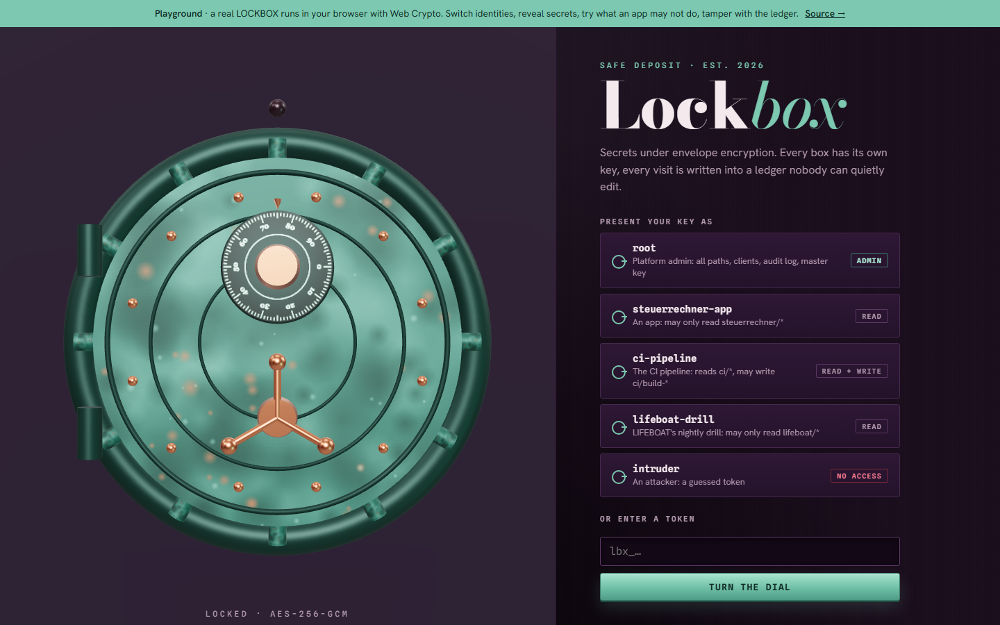
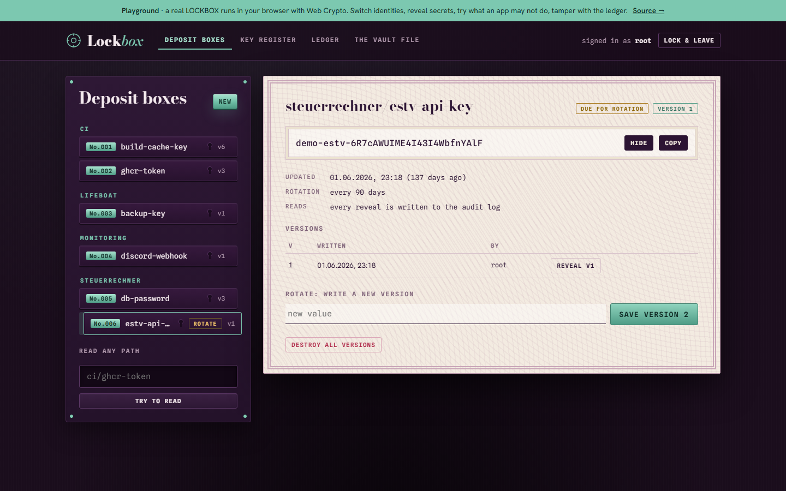
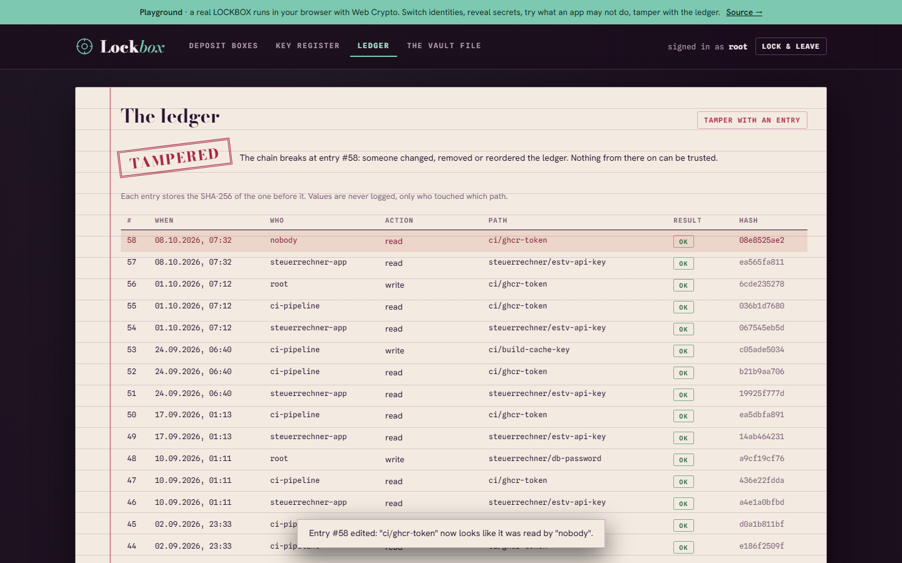
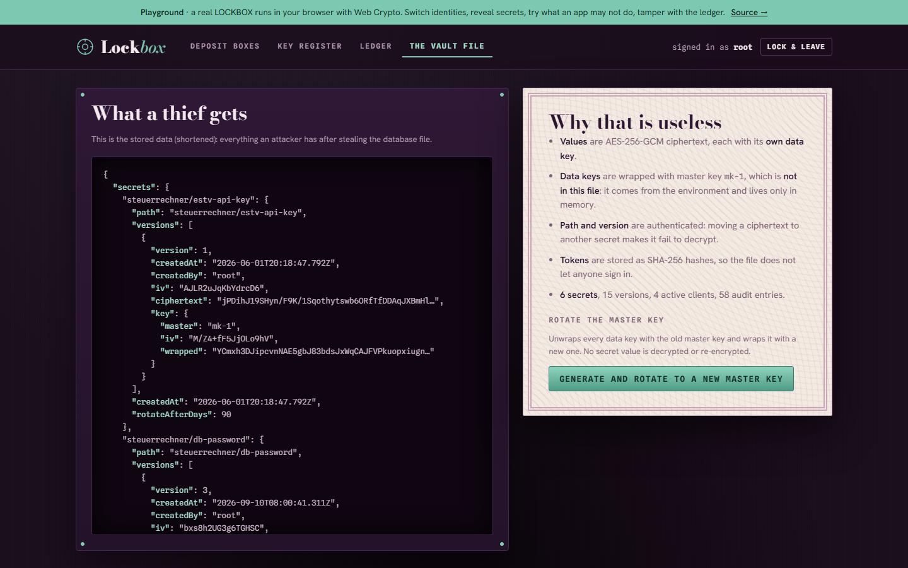
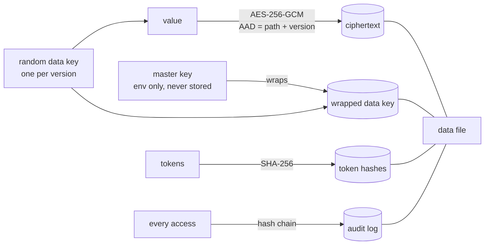

# LOCKBOX

**A small secrets manager.** Apps ask LOCKBOX for their passwords and API keys instead of keeping them in code or `.env` files. Every value is encrypted with its own key, every app only sees what its rules allow, and every access lands in an audit log that cannot be edited without it showing.

[**Playground**](https://notdom1n1c.github.io/lockbox/): a real LOCKBOX running in your browser (same code, Web Crypto). Sign in as an admin, an app, the CI pipeline or an attacker. Reveal secrets, try what an app may not do, tamper with the audit log, look at what a thief would get from the data file, and rotate the master key.


Built by Dominic Aebersold (Informatiker EFZ Plattformentwicklung) as a portfolio project, next to [LAUNCHPAD](https://github.com/NotDom1n1c/launchpad) and [LIFEBOAT](https://github.com/NotDom1n1c/lifeboat). Node 24, no dependencies.

## Screenshots

**Sign-in**: a vault door in three.js. The combination dial turns as you type the token; on success the wheel turns, the bolts retract and the door swings open, a wrong token makes it shudder.



**Secrets**: values stay hidden until revealed, and every reveal is audited. Old secrets are flagged for rotation.



**Audit log**: hash-chained. Editing one entry (here: hiding who read a secret) breaks the chain from that point.



**Storage**: everything a thief gets from the data file, and why it is useless without the master key



## How a secret is stored



- **Envelope encryption.** Each secret version gets a random 256-bit data key. The value is encrypted with it; the data key is encrypted ("wrapped") with the master key. The master key comes from `LOCKBOX_MASTER_KEY` and only lives in memory.
- **Bound to its place.** Path and version are authenticated data. A ciphertext copied to another secret in the file no longer decrypts.
- **Master key rotation without touching values.** `rotate-master` unwraps every data key with the old master key and wraps it with the new one. Start with the wrong master key and LOCKBOX refuses to start.
- **Least privilege.** Clients (apps, people, pipelines) have their own tokens and rules like `steuerrechner/* → read, list`. Deny by default. Tokens are only stored as SHA-256 hashes and shown once.
- **Tamper-evident audit log.** Every read, write, denial and failed login is logged with the SHA-256 of the entry before it. Changing, deleting or reordering an entry breaks the chain from there on. Values never reach the log.
- **Rotation reminders.** Secrets can carry "rotate after N days" and are flagged when they are older.
- **Brute-force brake.** 10 failed logins per minute per address, then HTTP 429.

## Use it

```bash
docker run -d -p 8200:8200 -v lockbox:/data \
  -e LOCKBOX_MASTER_KEY="$(head -c 32 /dev/urandom | base64)" ghcr.io/notdom1n1c/lockbox
docker logs <container>     # first start prints the root token once
```

Or without Docker: `LOCKBOX_DEV=1 npm start` (throwaway key, in memory), then open http://localhost:8200.

| Endpoint | |
|---|---|
| `PUT /v1/secrets/{path}` `{value, rotateAfterDays}` | write a new version |
| `GET /v1/secrets/{path}[?version=N]` | read (audited) |
| `GET /v1/list?prefix=` | what this client may list, with versions and staleness |
| `DELETE /v1/secrets/{path}` | destroy all versions (the data keys are deleted, values unrecoverable) |
| `GET/POST /v1/clients`, `DELETE /v1/clients/{name}` | manage clients (admin) |
| `GET /v1/audit` | log + chain verification (admin) |
| `POST /v1/sys/rotate-master` `{key, id}` | rotate the master key (admin) |

### Secrets as environment variables

```bash
export LOCKBOX_ADDR=http://localhost:8200 LOCKBOX_TOKEN=lbx_...
lockbox put steuerrechner/db-password -          # reads the value from stdin
lockbox run --prefix steuerrechner/ -- node server.js
```

`run` starts the app with `DB_PASSWORD=...` in its environment. The secrets exist only in that process's memory, and the child does not get `LOCKBOX_TOKEN`.

## Tests

`npm test`: 18 tests, including:

- values and data keys never appear in the stored file, tokens only as hashes
- a ciphertext moved to another secret fails to decrypt
- an app reads its own secret, is denied everything else, and both are audited
- rotation re-wraps without re-encrypting, the old master key stops working
- audit chain detects edits, deletions and reordering
- CLI `run` injects secrets as environment variables and hides the token
- 10 wrong tokens, then 429

CI also builds the image, smoke-tests it (data survives a restart, a wrong master key is refused), scans it with Trivy and pushes it to GHCR.

## Layout

```
public/core/crypto.js   Web Crypto helpers (AES-256-GCM, SHA-256), same file in Node and browser
public/core/lockbox.js  envelope encryption, versions, clients, rotation
public/core/policy.js   path rules, deny by default
public/core/audit.js    hash-chained audit log
public/                 web UI; demo.js seeds the browser playground
src/server.js           HTTP API, brute-force brake, security headers
src/filestore.js        atomic JSON file store
src/cli.js              ls / get / put / run
```

## License

MIT
